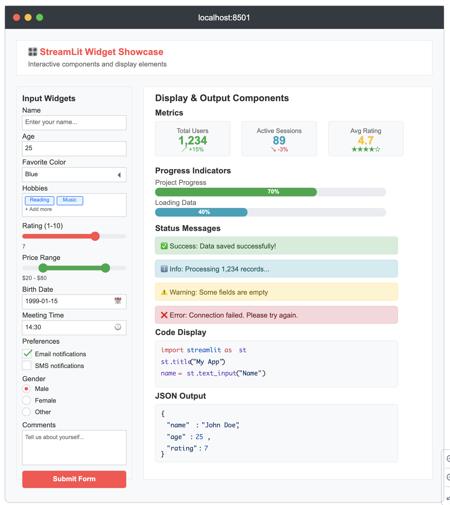

# Session 7: Streamlit — Byg en frontend i ren Python

**Uge 43 | Python Elective 2026 Fall**

> Byg en web-frontend uden HTML og JavaScript — kun Python. Lær Streamlits widgets, layout og sider, og giv jeres bog-API fra session 5–6 en brugerflade.

---

## Læringsmål

- Du ved, hvad [Streamlit](https://streamlit.io/) er, og hvornår det er et godt valg
- Du kan vise tekst, Markdown og data i en Streamlit-app
- Du kan bruge interaktive widgets (`text_input`, `slider`, `selectbox`, `button` …) og reagere på brugerens input
- Du kan strukturere en app med kolonner, sidebar og flere sider
- Du forstår, at Streamlit kører hele scriptet forfra, hver gang brugeren gør noget
- Du kan bygge en lille MVP-frontend, der henter og sender data til en API med `httpx`

---

## Før undervisningen

- Dan dig et overblik over, hvad [Streamlit](https://streamlit.io/) er og kan — kig i [galleriet](https://streamlit.io/gallery) og [dokumentationen](https://docs.streamlit.io/).
- Sørg for, at din bogreols-API fra session 5 kører, og at din `library_client.py` fra session 6 virker. I dag får de en brugerflade.
- Brainstorm: Hvilket lille værktøj kunne du tænke dig at bygge med Streamlit?

---

## Dagens undervisning

### Kom i gang

```bash
uv init streamlit_demo
cd streamlit_demo
uv add streamlit httpx
```

Lav `app.py`:

```python
import streamlit as st

st.title("Hello World!")
st.write("Velkommen til min første Streamlit-app.")

name = "Claus"
st.write(f"Hej, {name}!")
```

Kør den — Streamlit åbner selv browseren på `http://localhost:8501`:

```bash
uv run streamlit run app.py
```

Gem filen, og tryk **Rerun** i browseren (eller slå **Always rerun** til), så ser du ændringerne med det samme.

### Tekst og Markdown

```python
st.markdown("""
# Hello world
Her er noget brødtekst.

## Vi bruger Markdown
* Punkt 1
* Punkt 2
""")
```

En streng, der står alene på en linje, bliver også vist som Markdown — Streamlit kalder det *magic*:

```python
"""
# Hello world
Her er noget brødtekst.
"""
```

### Interaktive widgets

```python
x = st.slider("Antal biler", 0, 100, 10)
st.write(f"Du har valgt {x} biler.")

alder = st.text_input("Hvad er din alder?")
st.write(f"Din alder er: {alder}")

if st.button("Klik på mig"):
    st.write("Knappen blev klikket!")

s = st.selectbox("Hvad er din alder?", [12, 13, 33, 66])
if s >= 18:
    st.success("Velkommen!")
else:
    st.error("Du er ikke gammel nok.")
```

**Vigtigt:** Hver gang brugeren ændrer en widget, kører Streamlit **hele** `app.py` forfra, fra øverste linje. Widgets returnerer deres nuværende værdi — derfor kan du bruge dem som almindelige variabler. Vil du huske noget mellem kørsler (fx en liste, der vokser), skal det i `st.session_state`.

### Layout: kolonner og sidebar

```python
col1, col2 = st.columns(2)
with col1:
    st.button("Klik på mig")
with col2:
    st.write("# Hej derovre")

st.sidebar.title("Sidebar")
st.sidebar.button("Klik på mig")
```

### Flere sider

Læg en mappe `pages/` ved siden af `app.py`. Hver fil i den bliver automatisk en side i menuen:

```
my_app/
├── app.py
└── pages/
    ├── page1.py
    └── page2.py
```

### Hent data fra en API

Samme `httpx` som i session 6 — nu vises resultatet bare i browseren i stedet for i terminalen:

```python
import httpx
import streamlit as st

st.title("GitHub-bruger")

username = st.text_input("Brugernavn", "octocat")

if st.button("Hent"):
    try:
        response = httpx.get(f"https://api.github.com/users/{username}", timeout=5)
        response.raise_for_status()
        user = response.json()
        st.image(user["avatar_url"], width=120)
        st.metric("Public repos", user["public_repos"])
    except httpx.HTTPStatusError:
        st.error(f"Brugeren '{username}' blev ikke fundet")
    except httpx.RequestError as e:
        st.error(f"Kunne ikke kontakte API'et: {e}")
```

- `st.spinner("Henter …")` viser en loading-indikator, mens kaldet kører
- `st.json(data)` er en hurtig måde at se, hvad API'et faktisk returnerer

---

## Opgaver

### Opgave 1: En frontend til din bog-API

Byg en Streamlit-frontend til bogreols-API'en fra session 5. Kør API'en i én terminal og Streamlit i en anden:

```bash
uv run main.py                         # terminal 1: din API fra session 5
uv run streamlit run app.py            # terminal 2: frontenden
```

1. **Vis bøgerne.** Hent alle bøger, og vis dem — fx med `st.dataframe` eller én linje pr. bog. Vis om hver bog er udlånt.
2. **Tilføj en bog.** Lav en formular (`st.form` + `st.text_input` + `st.form_submit_button`), der sender en `POST` til jeres API. Husk API-nøglen fra session 6 — læs den fra `.env`, ligesom i klienten.
3. **Lån og aflever.** Giv hver bog en knap til at låne den ud eller aflevere den.
4. **Når det går galt.** Vis en tydelig `st.error`, hvis API'en ikke kører, eller hvis den svarer med en fejl (400, 401, 404) — ingen stack traces i browseren.

Hvis din API ikke virker, så brug en medstuderendes, eller få AI til at generere en ud fra jeres `swagger.json`.

### Opgave 2: GitHub Explorer

Byg en app, der søger efter GitHub-brugere med [GitHub's REST API](https://docs.github.com/en/rest). GET-requests til offentlige data kræver ingen token.

1. **Bruger-søgning.** Et `st.text_input` til brugernavnet. Hent `https://api.github.com/users/{username}`, og vis avatar (`st.image`), navn og bio, samt followers, following og public repos (`st.metric`). Håndtér en bruger, der ikke findes.
2. **Repositories.** Hent `https://api.github.com/users/{username}/repos`, og vis for hvert repo: navnet som link (`st.markdown` med `[tekst](url)`), beskrivelse, sprog og antal stjerner.
3. **Filtrering og sortering.** En `st.selectbox` til sortering (flest stjerner, nyeste, alfabetisk) og en `st.multiselect` til at filtrere på sprog — vis kun de sprog, der faktisk bruges.
4. **Ekstra — flere sider.** Del appen op i `app.py` (søgning), `pages/repos.py` (repo-oversigt) og `pages/compare.py`, der sammenligner to brugere side om side med `st.columns`. Brug `st.session_state` til at huske brugernavnet på tværs af sider.

### Opgave 3 (ekstra): Mock-up

Byg en app, der ligner billedet herunder.



**Input-widgets (sidebar):** `st.text_input`, `st.number_input`, `st.selectbox`, `st.multiselect`, `st.slider`, `st.select_slider`, `st.date_input`, `st.time_input`, `st.checkbox`, `st.radio`, `st.text_area`, `st.button`

**Output (hovedområdet):** `st.metric` (med delta), `st.progress`, `st.success` / `st.info` / `st.warning` / `st.error`, `st.code`, `st.json`

---

## Efter undervisningen

- Sørg for, at du kan forklare, hvorfor Streamlit kører hele scriptet forfra, og hvad `st.session_state` løser
- Gør din bog-frontend færdig, så den kan vise, tilføje, låne og aflevere bøger
- Eksperimentér: stop API'en mens frontenden kører, og se, at din fejlhåndtering holder
